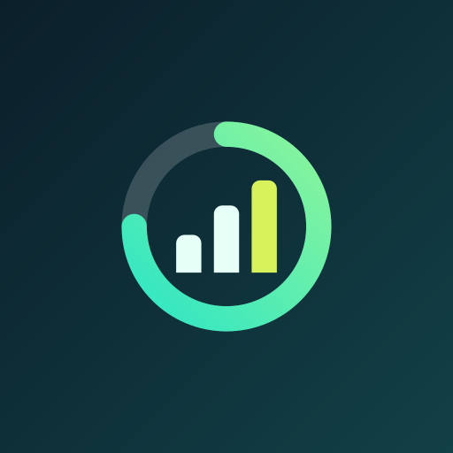

  

  
  

# Kaizen

Kaizen is a simple, local-first screen-time tracker for Android. See today's usage, explore your most-used apps, and look back at your history.

## Why you'll like it

- **Understand your day:** View total screen time and your top apps at a glance.
- **Explore your usage:** Browse installed apps, search them, and open each app's history.
- **Spot patterns:** Switch between daily, weekly, and monthly usage charts.
- **Make it yours:** Choose system, light, or dark mode; Material You or a preset palette; and optional OLED black.
- **Keep it private:** Usage history stays on your device—Kaizen does not request internet access.

## License

Kaizen is licensed under the [Unabandon Public License (UPL)](LICENSE.md).

## Credits

Preconfigured theme palettes are inspired by [Dartotsu](https://github.com/aayush2622/Dartotsu).
